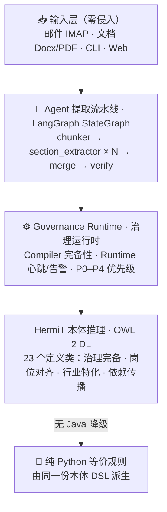
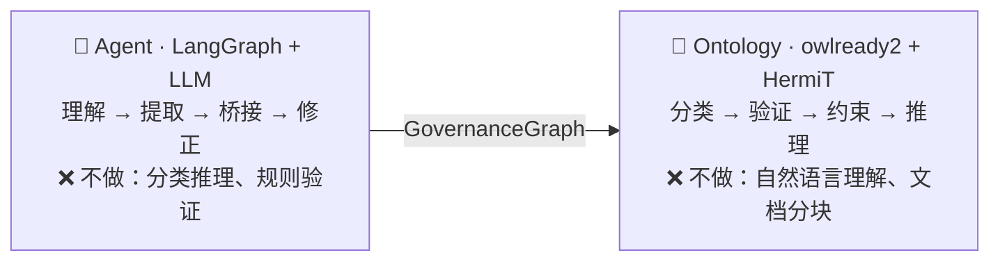

<div align="center">

# MOSS

**ERP 管资源 · CRM 管客户 · OA 管流程 · MOSS 管决策**

<sub>OWL 2 DL + HermiT 决策治理运行时 · 行业原型 × 岗位职责组织本体 · [OntologyOps](https://github.com/georgewangchn/OntologyOps) 方法论参考实现</sub>

[](https://www.python.org/) [](LICENSE) [](src/moss/resources/ontology/LICENSE) [](src/moss/resources/ontology/PROTOCOL.md) [](https://github.com/georgewangchn/OntologyOps) [](#-诚实定位) [](https://github.com/georgewangchn/MOSS/actions/workflows/ci.yml)

**本体即代码** · **LLM 只做提取** · **推理机做裁判** · **零侵入接入**

[快速开始](#-快速开始) · [60 秒体验](#-60-秒体验组织治理) · [特性](#-核心特性) · [架构](#-架构) · [文档](#-文档中心) · [Roadmap](#-roadmap) · [贡献](#-贡献) · [定位](#-诚实定位)

</div>

---

## 📖 这是什么

企业软件三十年，管了资源、客户、流程，唯独没人管「决策」——会议结束，决策就消亡：没有追踪、没有问责、没有复盘。

MOSS 把决策变成**可追踪、可验证、可持续执行**的第一管理对象。底下是 OWL 2 DL 与 HermiT Tableau 推理算法，不是又一个待办清单。核心铁律：

> **LLM 只做提取，推理机做裁判。LLM 永不进入推理链。**

优先级 P0–P4 由规则推断，不由人定；治理完备性由 OWL 等价类自动归类，零人工打标签。

---

## ⚡ 快速开始

> **前置**：Python 3.10+。可选：Java 11+（HermiT 推理）、Ollama 或 OpenAI 兼容 API（LLM 提取）。

```bash
git clone https://github.com/georgewangchn/MOSS.git
cd MOSS
python -m venv venv && source venv/bin/activate
pip install -e ".[agent]"          # 最小安装（无 LLM）: pip install -e .
```

```bash
moss init      # 交互式向导：工作区 · LLM · Java 检测 · 公司原型选择
moss demo      # 加载预置种子数据，立即体验完整治理流程
moss serve     # 启动 Web 驾驶舱 → http://localhost:8000
```

无 LLM、无 Java 照样能跑（自动降级）。

---

## 🎬 60 秒体验：组织治理

MOSS 内置**分层组织本体**：通用高管层（所有公司一致）+ 典型公司原型层（行业特化岗位与业务域）。选一个原型，决策的「岗位-职责对齐」自动进入推理：

```bash
# 向导第 4 步选择公司原型（或直接改 .env）
MOSS_ARCHETYPE=pharma moss hermit
```

```
role_aligned      ['demo-003']      ← 首席财务官 管 财务域 → 对齐
role_misaligned   ['demo-002']      ← 首席财务官 牵头供应商切换(供应链域) → 越权
role_unregistered ['demo-004']      ← 「分管副总」不在词汇表 → 数据治理信号
```

```bash
moss org list            # 4 个内置原型：化学制药 / 三级医院 / 动力电池 / 互联网医疗
moss org show pharma     # 展示通用岗位层 + 药厂专业岗位层（职责/别名/汇报关系）
moss compile             # 岗位越权作为治理检查项进入报告
```

**换公司 = 换一个环境变量。** 同一份治理数据，药厂模式识别 GMP 生产决策、电池厂模式识别电池安全决策，通用层恒定不变。新增行业原型只需在 [`moss.onto.yaml`](src/moss/resources/ontology/moss.onto.yaml) 追加一段 YAML——零代码。

---

## 🌟 核心特性

| | 特性 | 做什么 |
|:---:|---|---|
| 🧬 | **本体即代码** | 声明式 DSL 为唯一事实源，`validate / build / diff / tag / rollback`，编译成 OWL 2 DL 交 HermiT 推理 |
| 🧠 | **推理机裁判** | 「治理完备」「岗位越权」被形式化为 OWL 等价类，HermiT 自动归类，零人工打标签 |
| 🏢 | **分层组织本体** | 通用岗位层 + 行业原型层（药企/医院/电池/互联网医疗），岗位职责覆盖判定、行业特化语义随原型切换 |
| 🤖 | **LLM 只做提取** | LangGraph Agent 把周报/纪要/邮件抽成结构化决策，词汇表注入抽取契约，推理裁判权始终在推理机 |
| 🔌 | **零侵入接入** | 邮件(IMAP) / 文档(Docx/PDF) / CLI / Web，不改造任何现有系统 |
| 🛡️ | **开箱降级** | 无 Java、无 LLM 也能跑；推理降级由**同一份本体 DSL** 派生，不漂移 |
| ⚖️ | **双向治理** | 既向下问责，也向上追溯——上级的支持责任同样超期告警、自动升级 |

---

## 🏗️ 架构



<details>
<summary><b>规则驱动优先级（P0–P4）</b></summary>

优先级从治理状态自动计算（`compute_priority`），不是人工设定字段——**消除「谁的嗓门大谁优先级高」的主观偏差**：

| 级别 | 严重度 | 规则 |
|:----:|:------:|------|
| **P0** | 🔴 紧急 | `Governed`（owner + deadline + update）∧ 距截止不足 8 整天 ∧ risk=HIGH |
| **P1** | 🟠 高 | `Governed`（治理完备，全部检查通过） |
| **P2** | 🟡 中 | hasOwner + hasDeadline（缺进展更新） |
| **P3** | 🟢 低 | hasOwner（缺截止日期） |
| **P4** | ⚪ 待处理 | 无负责人 / 已完成 |

</details>

<details>
<summary><b>OWL 定义类（23 个，HermiT 自动分类）</b></summary>

围绕 **Decision / Issue / Update** 三概念建图（`hasUpdate`、`dependsOn` 关系边），定义类分五族：

```
# 治理完备族
GovernedDecision     ≡ Decision ⊓ ∃hasOwner ⊓ ∃hasDeadline ⊓ ∃hasUpdate
HasOwnerDecision     ≡ Decision ⊓ ∃hasOwner
HasDeadlineDecision  ≡ Decision ⊓ ∃hasDeadline

# 优先级/风险/状态族（值约束）
CriticalDecision     ≡ hasPriority value "P0"      HighPriorityDecision ≡ "P1"
HighRiskDecision     ≡ hasRiskLevel value "HIGH"   BlockedDecision ≡ status "BLOCKED"
DoneDecision         ≡ status value "DONE"

# 时间语义族（computed 布尔桥接：值由 loader 计算，非 LLM）
OverdueDecision ≡ ∃isOverdue    StaleDecision ≡ ∃isStale    StaleUpdate ≡ ∃isStaleUpdate

# 依赖/议题族
HasDependencyDecision       ≡ ∃dependsOn.Decision
BlockedDependencyDecision   ≡ ∃dependsOn.BlockedDecision
CriticalIssue               ≡ Issue ⊓ hasSeverity value "CRITICAL"

# 组织治理族（行业原型 × 岗位职责）
RoleAlignedDecision         ≡ ∃isRoleAligned          # 岗位职责覆盖业务域
RoleMisalignedDecision      ≡ ∃isRoleMisaligned       # 在册岗位但职责越权
RoleUnregisteredDecision    ≡ ∃isRoleUnregistered     # 岗位不在词汇表（数据治理）
RegulatedProductionDecision ≡ 医药 ∧ GMP生产          # 行业特化族，另见电池安全/医务管理/医疗内容合规
```

全部定义类经 **HermiT ↔ 纯 Python fallback 双推理路径等价测试**守护（含原型切换场景）。

</details>

<details>
<summary><b>Agent 与本体分工：LLM 永不进推理链</b></summary>



- **LLM 只做 NLU**：把周报 / 纪要 / 邮件抽成结构化决策，理解这一步允许有错。组织词汇表（岗位/业务域标准名）注入抽取契约，LLM 直接输出标准名
- **HermiT 只做推理**：谁是 `GovernedDecision`、谁该进 P0、谁的岗位越权——由 OWL 2 DL 等价类自动归类，**零人工打标签、LLM 不参与裁判**

</details>

---

## 📚 Ontology Repo：把本体当代码治理

OntologyOps 六大支柱之一在本项目的落地。本体不再硬编码在 Python，而是一份**声明式 DSL**（[`moss.onto.yaml`](src/moss/resources/ontology/moss.onto.yaml)）作为唯一事实源——标准 OWL 2 DL 的对 LLM 友好、对 diff 友好的语法，编译后交 HermiT 推理，并可导出标准 W3C Turtle。组织词汇表（岗位/原型/职责）同为 DSL 段，受同一套版本化治理。

```bash
moss onto validate               # 校验 DSL（JSON Schema + 模型）
moss onto show                   # 树形展示概念 / 属性 / 定义类
moss onto build [--commit -m …]  # 编译成 OWL TBox，产出 moss.{owl,ttl,lock.json}
moss onto log                    # 版本历史（HEAD → 根）
moss onto diff [A] [B]           # 语义级 Diff（标注是否 breaking）
moss onto tag <name> [ver]       # 打版本标签
moss onto rollback <ver>         # 回滚：还原工作区 DSL 并前移 HEAD
moss onto conformance [--json]   # 符合性自证报告（18 条款，core + governance）
moss org list / show <id>        # 组织词汇表：原型列表 / 岗位职责树
```

> **为什么用 DSL 而非手写 `.owl`**：本体由 LLM 生成时，带空白节点的 Turtle 既易错又难 review；带 JSON Schema 的 DSL 在生成那一刻被约束，且天然可 diff、可 PR。版本化已实现（SQLite 内容寻址版本库），Branch / Merge 为下一增量。协议契约见 [`PROTOCOL.md`](src/moss/resources/ontology/PROTOCOL.md)。

---

## 🖥️ Web 驾驶舱

`moss serve` 启动单页仪表盘，无需切换 Tab 即完成输入、看板、推理、告警、日志的联动：

- **状态栏** — 决策总数 / 高危 / 超期 / 已完成 + 时钟
- **输入栏** — 自然语言输入 → IntentAgent 自动路由（`分配给王工` → AMEND、`检查` → CHECKPOINT、周报文本 → INGEST）
- **看板 + 告警** — 决策列表（按优先级排序、风险指示）+ 编译错误 / 治理警告 / 活跃告警
- **本体面板** — HermiT 推理状态（治理完备 / 需关注 / 需处理）、P0–P4 优先级分布
- **日志** — 事件时间线，SSE 实时推送 + 历史回放，CLI / Web 操作实时同步

<details>
<summary><b>降级策略</b></summary>

| 组件 | 完整模式 | 降级模式 |
|------|----------|----------|
| LLM | 云端 API / 本地 Ollama | 无 LLM 模式（demo 用预置数据） |
| 推理 | HermiT Tableau（需 Java 11+） | 纯 Python 等价规则（由**同一份本体 DSL** 派生） |
| 提取 | LangGraph Agent 并行 | Extractor 单线程分段（组织词汇表注入保持一致） |
| 原型 | `MOSS_ARCHETYPE` 行业语义 | 不设置 = 通用治理模式（行业类静默，通用岗位层仍生效） |

降级后功能零损失，仅丢失形式化保证与并行加速。

</details>

---

## 🧰 命令清单

| 命令 | 说明 |
|------|------|
| `moss init` · `demo` | 初始化工作区（含公司原型选择）/ 加载演示数据 |
| `moss ingest <file>` | 从文件提取决策（.txt/.md/.docx/.pdf），`-` 从 stdin |
| `moss amend <id> --owner-role … --domain …` | 修改决策属性（含岗位/业务域） |
| `moss connect email` · `daemon` | 配置邮件接入（IMAP）/ 守护进程定时拉取 |
| `moss compile` | 编译检查（完备性 + 岗位越权 + 未注册岗位） |
| `moss checkpoint` | 治理心跳（逾期 / 停滞 / 阻塞检测 + 自动升级） |
| `moss hermit` | 展示 OWL 本体分类结果（23 个 result_key 全量） |
| `moss org list` · `org show <id>` | 组织词汇表：原型列表 / 岗位职责树 |
| `moss status` · `graph` · `attention` · `brief` · `alert` | 状态 / 图 / 待办 / 简报 / 告警 |
| `moss onto …` | Ontology Repo：validate / build / diff / tag / rollback / conformance |
| `moss serve` | 启动 Web 驾驶舱 |
| `moss reset` · `migrate` | 清空数据 / 从旧 JSON 迁移到 SQLite |

> 完整清单以 `moss --help` 为准。

---

## 🗺️ Roadmap

- [x] OWL 2 DL 推理运行时（HermiT + DSL 派生 fallback 双路径等价）
- [x] Ontology Repo：DSL 版本库（validate/build/diff/tag/rollback/conformance）
- [x] 12 治理场景 × 多轮会议/邮件交互模拟测试套件
- [x] 分层组织本体：通用岗位层 + 4 行业原型 + 岗位职责对齐推理
- [x] GitHub Actions CI — 6 作业矩阵（Python 3.10/3.12 × HermiT/fallback × agent/无 langchain）+ 本体 DSL 静态检查
- [ ] **Branch / Merge** — 本体版本库分支模型
- [ ] **更多行业原型** — 金融银行 / 教育K12 / 物流供应链（纯 YAML 词汇数据，零代码）
- [ ] **Web 驾驶舱组织面板** — 错配决策可视化标记
- [ ] **真实语料回归集** — 会议纪要/周报语料库驱动抽取-判定链路准确率度量
- [ ] **rules: 外置** — 优先级/完备性规则从 Python 迁入 DSL（协议增量）
- [ ] **dependsOn 传递性** — 属性特征语法（间接依赖链传播）

> Roadmap 项欢迎认领——见[贡献](#-贡献)。

---

## 🤝 贡献

Issue / PR 均欢迎。开发环境与规范见 [CONTRIBUTING.md](CONTRIBUTING.md)：

```bash
pip install -e ".[agent,dev]"
pytest                                              # 46 个测试，含 HermiT 等价哨兵
moss onto conformance                               # 协议符合性须全绿
```

**添加新行业原型不需要写代码**：在 `moss.onto.yaml` 的 `org.archetypes` 追加一段原型定义（行业 + 业务域 + 岗位 + 别名），过 schema 校验与别名撞名守卫即可——这是为「每家公司一套本体」痛点设计的扩展缝。

---

## 📚 文档中心

| 文档 | 内容 |
|------|------|
| [`CONTRIBUTING.md`](CONTRIBUTING.md) | 开发环境、分层许可、提交规范、发布流程 |
| [`TRADEMARK.md`](TRADEMARK.md) | MOSS 名称使用指引 |
| [`src/moss/resources/ontology/PROTOCOL.md`](src/moss/resources/ontology/PROTOCOL.md) | OntologyOps Ontology Repo 协议契约（MOSS 为参考实现） |
| [`src/moss/resources/ontology/moss.onto.yaml`](src/moss/resources/ontology/moss.onto.yaml) | 本体 DSL + 组织词汇表（唯一事实源） |
| [`tests/test_scenarios.py`](tests/test_scenarios.py) | 14 个治理场景模拟（每场景 5-8 轮会议/邮件交互） |
| [`.env.example`](.env.example) | 全部配置项说明 |

---

## 💡 为什么需要 MOSS

| 时代 | 管理对象 | 代表系统 | 决策？ |
|:----:|:--------:|:--------:|:-----:|
| 1990s | 📦 资源 | ERP | ✗ |
| 2000s | 👥 客户 | CRM | ✗ |
| 2010s | 🔄 流程 | OA/BPM | ✗ |
| **现在** | 🎯 **决策** | **MOSS** | **✓** |

每个组织都遇到过：

1. **决策无法落地** — 会议有结论，但没有追踪机制，事项逐渐石沉大海
2. **责任靠人治** — 跨部门决策谁催办、何时做，全靠主动性和人情
3. **无法监督上级** — 系统只向下问责，上级该支持没支持，无人知晓
4. **治理效果不可量化** — 决策不是结构化对象，无法统计、预警、复盘

MOSS 的回答——**把决策变成可追踪、可验证、可持续执行的第一管理对象**，以机制代替人治：

- 决策缺负责人或截止日期 → **ERROR，不可跳过**
- 优先级 P0–P4 **完全由规则推断，不由人定**
- 岗位指派错配（财务总监管 GMP 生产）→ **治理信号，自动标记**
- 系统主动催办、超期告警、自动升级——**既向下问责，也向上追溯**

---

## 🧪 技术栈

`owlready2 + HermiT`（OWL 2 DL Tableau） · `LangGraph`（多步 LLM 编排） · `FastAPI + SSE` · `Click + Rich`（CLI） · `Pydantic` · `SQLite`（WAL） · `rdflib`（Turtle 导出）

本体以声明式 DSL 为源、编译 owlready2 TBox、导出标准 Turtle；SQLite 同时承载运行时图与本体版本仓库。

---

## 🎯 诚实定位

> MOSS 是一个功能完整、可运行、可演示的**原型**，**不是**已服务大批客户的成熟产品。它证明的是「这套方法论能用开源工具链完整落地」，而非「已被市场规模验证」。这两件事必须分清。

<details>
<summary><b>历史沿革</b></summary>

本项目由 `GovernanceOps` 更名为 `MOSS`：包名 `governanceops` → `moss`，CLI `govops` → `moss`，workspace `~/.governance-ops/` → `~/.moss/`，品牌 env 前缀 `GOVOPS_*` → `MOSS_*`（`LLM_API_URL`/`APP_*` 等通用名配置保持不变）。历史提交完整保留。

</details>

---

## 🔗 相关项目

- **[OntologyOps](https://github.com/georgewangchn/OntologyOps)** — 本项目所实现的方法论与协议，含方法论体系与博客系列
- [`PROTOCOL.md`](src/moss/resources/ontology/PROTOCOL.md) — Ontology Repo 支柱的协议契约（MOSS 为其参考实现）

---

## License

本仓库采用**分层许可**：

| 资产类型 | 许可协议 | 覆盖范围 | 说明 |
|---------|---------|---------|------|
| **代码** | [MIT](LICENSE) | src/moss/ 代码、tests、demo | 自由使用、修改、商用 |
| **协议规范** | [CC BY 4.0](src/moss/resources/ontology/LICENSE) | src/moss/resources/ontology/ | 署名 + 允许商业实现 |

> `src/moss/resources/ontology/` 下的协议规范权威源在 [OntologyOps 仓库](https://github.com/georgewangchn/OntologyOps)，以 CC BY 4.0 发布。无论从哪个仓库获取，协议许可始终为 CC BY 4.0。

项目名称使用指引见 [TRADEMARK.md](TRADEMARK.md)。

<div align="center">
<br>
<sub>Built with OWL 2 DL, HermiT & 一条不肯让 LLM 进推理链的铁律 · Code: MIT · Protocol: CC BY 4.0</sub>
</div>
